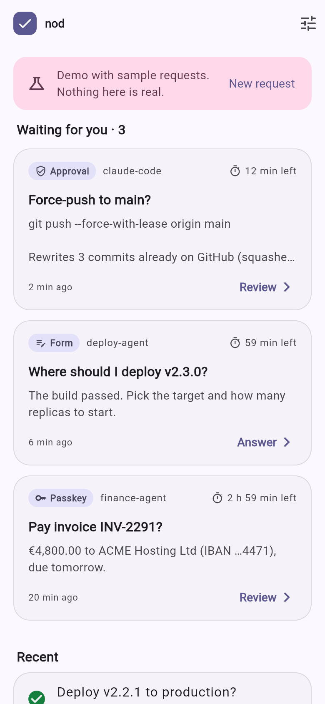
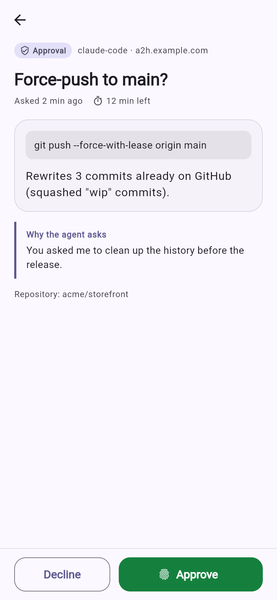
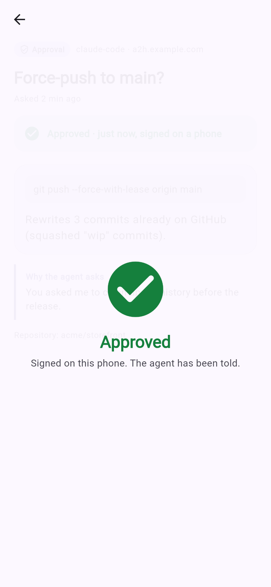
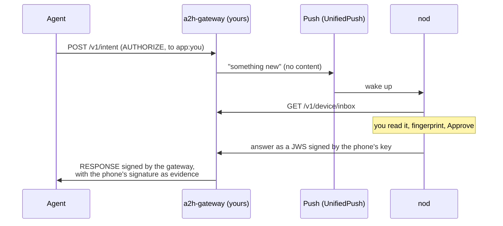

<p align="center"></p>

<h1 align="center">nod</h1>

<p align="center"><b>Approve what your AI agents want to do, from your phone.</b><br>
Open source. Self-hosted. No accounts, no tracking, no Google services.</p>

<p align="center">
  <a href="https://andreaacanfora.github.io/nod/">Try the web demo</a> ·
  <a href="#get-started">Get started</a> ·
  <a href="#how-it-works">How it works</a> ·
  <a href="#security">Security</a>
</p>

<p align="center">
  
  
  
</p>

---

Agents now run for hours on their own: they write code, deploy, pay invoices,
delete files. Sooner or later they hit something they should not do without
you. Today they stop and wait in a terminal you are not looking at.

**nod puts that question in your pocket.** The agent asks, your phone buzzes,
you read what it wants to do and why, and you approve with your fingerprint or
decline with a tap. The agent gets your answer, signed by a key that never
leaves your phone.

- **Approvals:** *“Force-push to main?”*, *“Run the migration on production?”*
- **Forms:** the agent asks which environment, how many replicas, a date.
- **Passkeys for high stakes:** requests marked `HIGH` open in the browser for
  a passkey.
- **History:** what you approved, declined, or let expire, and how.

nod speaks [A2H](https://github.com/twilio-labs/Agent2Human), the open
Agent-to-Human protocol, through
[a2h-gateway](https://github.com/AndreaAcanfora/a2h-gateway), a small server
you run yourself. Any agent that can make an HTTP request can use it, and
agents that speak MCP (Claude Code, Cursor, …) get it as a tool.

## Get started

**1. Run a gateway** (a single binary or a Docker image), behind HTTPS:

```sh
export A2H_API_KEY=$(openssl rand -hex 24)
docker run -d --name a2h -p 8080:8080 -v a2h:/data \
  -e A2H_BASE_URL=https://a2h.example.com \
  -e A2H_API_KEYS="my-agent:$A2H_API_KEY" \
  ghcr.io/andreaacanfora/a2h-gateway
```

**2. Pair your phone:**

```sh
docker exec a2h a2h pair -principal you
```

It prints a QR code. In nod, tap *Pair a gateway* and scan it.

**3. Let your agents ask.** From a script (with the
[`a2h` CLI](https://github.com/AndreaAcanfora/a2h-gateway/releases)):

```sh
export A2H_GATEWAY=https://a2h.example.com    # and A2H_API_KEY from step 1
a2h ask -to app:you "Deploy v2.3 to production?" && ./deploy.sh
```

From Claude Code or any MCP client, add the gateway's MCP server:

```sh
claude mcp add a2h -e A2H_GATEWAY=https://a2h.example.com -e A2H_API_KEY=$A2H_API_KEY \
  -- a2h mcp -to app:you
```

and tell the agent: *“Ask me with request_approval before pushing, deploying
or deleting anything.”*

## Install

| Platform | How |
|---|---|
| Android | APK from [Releases](https://github.com/AndreaAcanfora/nod/releases). F-Droid: coming. |
| iOS | Build from source for now (`flutter build ios`). |
| Try it | [Web demo](https://andreaacanfora.github.io/nod/) with sample requests |

Notifications on Android use [UnifiedPush](https://unifiedpush.org): install a
distributor such as [ntfy](https://ntfy.sh) (free, no Google account). Without
one, nod checks for requests whenever you open it.

## How it works



- **Pairing:** nod creates a P-256 key on the phone and sends only the public
  half. The pairing link works once and expires in an hour.
- **Push:** carries no content, so the push service never sees what the agent
  asked. nod fetches the request from your gateway.
- **Answers:** a compact JWS (ES256) over the interaction ID, the decision and
  the time. The gateway checks it and puts it in the RESPONSE, so an agent can
  verify your phone's signature without trusting the gateway's word.

The device API is in
[a2h-gateway/docs/app-api.md](https://github.com/AndreaAcanfora/a2h-gateway/blob/master/docs/app-api.md):
anyone can write another client.

## Security

- The private key lives in the Android Keystore or iOS Keychain (through
  `flutter_secure_storage`). Backups and device transfer are disabled, so it
  does not leave the phone.
- Approving and sending forms ask for your fingerprint, face or screen lock.
  Declining never does: saying no should be easy.
- The device token alone cannot approve anything: every answer must also be
  signed by the key.
- `HIGH` assurance requests need a passkey in the browser; nod will not
  approve them.
- No analytics, no crash reporting, no servers of ours. nod talks only to the
  gateways you pair and to your push distributor.

Found a problem? See [SECURITY.md](SECURITY.md).

## Build

```sh
flutter test                                   # unit and widget tests
A2H_BIN=path/to/a2h flutter test test/integration   # against a real gateway
flutter run                                    # on a phone
flutter build web -t lib/main_demo.dart        # the web demo
```

`lib/core/` is plain Dart (keys, signatures, the gateway API) and has no
Flutter dependency.

## Roadmap

- [ ] F-Droid
- [ ] Keys in the Secure Enclave / StrongBox, with biometrics bound to the key
- [ ] iOS push (needs an Apple developer account)
- [ ] Wear OS and Apple Watch: approve from the wrist
- [ ] Rich bodies: diffs and code with syntax highlighting

## License

MIT. Not affiliated with Twilio; A2H is their open protocol.
